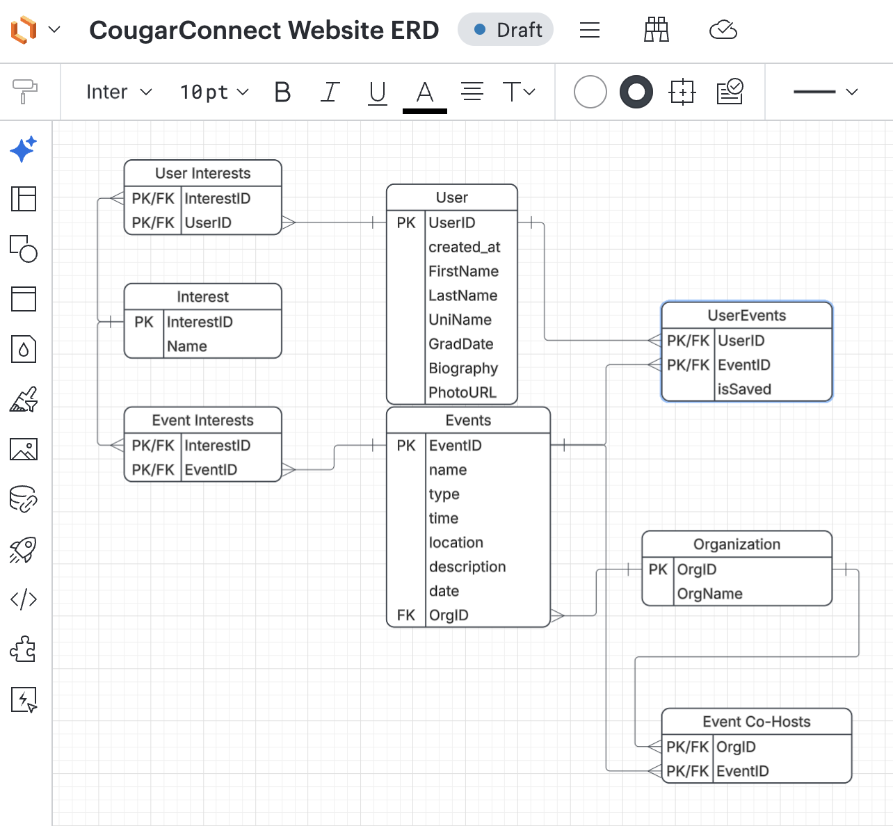

# Cougar Connect

## Access the Website

Open [http://stufordmachine.com:5676/](http://stufordmachine.com:5676/) in your web browser. You can type this URL directly into the address bar on macOS or Windows; include `http://` and the port `:5676`.

No Homebrew, Node.js, Git, or local server setup is required to use the hosted website. The local setup instructions below are for teammates developing or testing a local copy of the app.

## App Summary

BYU events are scattered across campus organizations, locations, and communication channels. Students can struggle to know where to look or which opportunities are relevant to them. Cougar Connect focuses first on an upperclassman who wants to build their résumé and get involved on campus. The app brings sample events into one place, with a searchable calendar and filters for interests, event type, time, location, and hosting organization. Students create a profile and select interests to discover opportunities that fit their goals. They can save events, review event details, and export events to their calendars. The team is connecting this responsive coursework app to Supabase for profile storage and email verification, providing a starting point for maintenance and support for additional student personas.

## ERD



The Step 1 ERD models User, Interest, Events, and Organization, with join tables for user interests, event interests, saved user events, and event co-hosts.

We are implementing a Supabase backend to persist all information entered on the Create Profile page: full name, university, study level, graduation month, primary interest, bio, and optional profile photo. Full name corresponds to FirstName and LastName; university, graduation month, bio, and photo correspond to UniName, GradDate, Biography, and PhotoURL. Study level and primary interest correspond to StudyLevel and PrimaryInterest in the ERD User table.

## Tech Stack

| Layer | Technology | Why it fits our prototype |
| --- | --- | --- |
| Structure | HTML5 (`dist/index.html`) | Standard form controls and a simple entry point without a build process. |
| Presentation | CSS (`dist/styles.css`) | Responsive desktop and mobile layouts without a UI framework. |
| Interaction | Vanilla JavaScript (`dist/app.js`) | Profile creation, interests, calendar filtering, search, and saved events in a directly editable codebase. |
| Persistence | Browser localStorage, key `cougar-demo` | Demonstrates persistence across refreshes without server setup. |
| Backend (in progress) | Supabase | The team is implementing shared backend persistence for every input on the Create Profile page, aligned with the ERD. |
| Data | Fictional sample events and locally created events | Lets the team demonstrate discovery before connecting real event sources. |
| Local tooling | Homebrew, Node.js, and npm | Homebrew installs Node.js and npm on macOS; npm installs dependencies, builds the app, and starts the local server. |
| Runtime | Modern web browser and the npm-started local server | Gives teammates a consistent way to run the Supabase integration branch. |

Supabase will send a verification email during account registration; users must follow the link in that email to verify their email address. The static files in this checkout still represent the earlier localStorage prototype.

## Local Development Setup (Optional)

To use the hosted website, open [http://stufordmachine.com:5676/](http://stufordmachine.com:5676/). Follow this section only to run a local development copy. If you already have the tools installed, skip to [Running a Local Copy After Initial Setup](#running-a-local-copy-after-initial-setup).

### macOS

1. On macOS, install Homebrew using the instructions at [brew.sh](https://brew.sh), then install Node.js and npm:

   ```sh
   brew install node
   node --version
   npm --version
   ```

2. Clone the repository and switch to the integration branch:

   ```sh
   git clone https://github.com/nickgcioffi/Cougar-Connect.git
   cd Cougar-Connect
   git checkout supabase-integration
   ```

3. Install dependencies, build the app, and start the local server:

   ```sh
   npm install
   npm run build
   npm start
   ```

4. Open the local app URL printed in the terminal. Keep the server running while using the app; press `Ctrl+C` to stop it.
5. Register using an email address you can access. **Supabase will send a verification email.** Check your inbox and spam folder, open the email, and follow its verification link. Return to the app and sign in if prompted.
6. Complete the Create Profile form and continue through interest selection.

### Windows

1. Install the LTS version of Node.js from [nodejs.org](https://nodejs.org/en/download), selecting the Windows installer. Keep npm and the option to add Node.js to PATH enabled. Install Git using the [Git for Windows installer](https://git-scm.com/downloads/win).
2. Open a new Command Prompt window after installation and verify the tools:

   ```bat
   node --version
   npm --version
   git --version
   ```

3. Clone the repository and switch to the integration branch:

   ```bat
   git clone https://github.com/nickgcioffi/Cougar-Connect.git
   cd Cougar-Connect
   git checkout supabase-integration
   ```

4. Install dependencies, build the app, and start the local server:

   ```bat
   npm install
   npm run build
   npm start
   ```

5. Open the local app URL printed in Command Prompt. Keep the server running while using the app; press `Ctrl+C` to stop it.
6. Register using an email address you can access. Check your inbox and spam folder for the verification email, follow its link, then return to the app and sign in if prompted.
7. Complete the Create Profile form and continue through interest selection.

If the integration branch requires Supabase configuration, use its environment-variable instructions or obtain the required configuration from the team. This static checkout contains no package manifest or Supabase configuration, so run the npm commands in the cloned team repository.

## Running a Local Copy After Initial Setup

Use macOS Terminal or Windows Command Prompt. You only need to install Homebrew, Node.js, and Git once. Having Homebrew installed alone does not install Node.js; if `node --version` or `npm --version` fails on macOS, run `brew install node` first.

### Tools Installed, but No Local Copy Yet

If Node.js, npm, and Git are already installed, start here:

```sh
git clone https://github.com/nickgcioffi/Cougar-Connect.git
cd Cougar-Connect
git checkout supabase-integration
npm install
npm run build
npm start
```

### Opening an Existing Local Copy

Open a terminal in your cloned `Cougar-Connect` folder (or use `cd` with its actual path), then run:

```sh
git checkout supabase-integration
npm start
```

If this copy has never been set up, run `npm install` and `npm run build` before `npm start`. For a copy that is already set up, `npm start` is enough to restart the app.

### Getting the Latest Team Updates

In your cloned repository, save and commit any local work before switching branches or pulling updates. Then run:

```sh
git checkout supabase-integration
git pull --ff-only origin supabase-integration
npm install
npm run build
npm start
```

If Git reports a conflict or that it cannot fast-forward, resolve the branch differences with the team before continuing.

After starting the server, open the local URL printed in the terminal and sign in with your existing verified account. Keep the terminal open while using the app; press `Ctrl+C` to stop the server. If the server is already running, you can open its URL directly. You do not need to register or verify your email again for an existing verified account.

## Verifying the Vertical Slice

The target working button is **Create profile →**: it should store all information entered on the Create Profile page in Supabase and allow the app to retrieve it after a refresh.

1. Start the integration branch using the instructions above, register, and verify your email through the link Supabase sends.
2. Enter a recognizable full name such as `John Doe`, select a university and study level, and enter a graduation month and primary interest. Add a distinctive bio such as `Looking for tech networking events` and an optional profile photo.
3. Click **Create profile →** and confirm that the app reports success or advances to the next onboarding step. Complete interest selection if prompted.
4. In the team's Supabase project (nickgcioffi's Org), confirm that the saved profile contains every submitted field, including the photo reference if a photo was uploaded.
5. Refresh the app, then open the profile or **Settings → Edit profile**. Confirm that the name, university, study level, graduation month, primary interest, bio, and optional photo are restored from the backend.
6. Sign out and sign back in with the verified account, then confirm that the same profile is available. This checks that the saved information is associated with the correct account.
