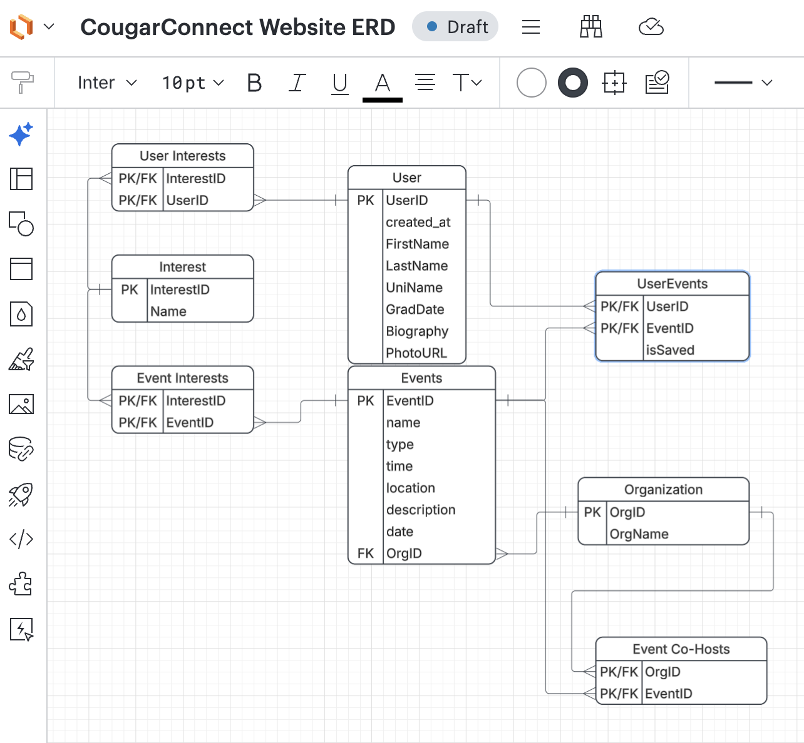

# Cougar Connect

## Access the Website

Open the official website at [https://cougarconnect.app/](https://cougarconnect.app/) in your web browser on macOS or Windows.

No installation or local server setup is required to use the hosted website. If you prefer localhost, follow [Run Locally (Optional)](#run-locally-optional) for macOS or Windows.

## App Summary

BYU events are scattered across campus organizations, locations, and communication channels. Students can struggle to know where to look or which opportunities are relevant to them. Cougar Connect focuses first on an upperclassman who wants to build their résumé and get involved on campus. The app brings sample events into one place, with a searchable calendar and filters for interests, event type, time, location, and hosting organization. Students create a profile and select interests to discover opportunities that fit their goals. They can save events, review event details, and export events to their calendars. The team is connecting this responsive coursework app to Supabase for profile storage and email verification, providing a starting point for maintenance and support for additional student personas.

## ERD



The Step 1 ERD models User, Interest, Events, and Organization, with join tables for user interests, event interests, saved user events, and event co-hosts.

We are implementing a Supabase backend to persist all information entered on the Create Profile page: full name, university, study level, graduation month, bio, and optional profile photo. Full name corresponds to FirstName and LastName; university, graduation month, bio, and photo correspond to UniName, GradDate, Biography, and PhotoURL. Study level corresponds to StudyLevel in the ERD User table.

## Tech Stack

| Layer | Technology | Why it fits our prototype |
| --- | --- | --- |
| Structure | HTML5 (`views/desktop/` and `views/mobile/`) | Separate desktop and mobile templates; see [view routing](docs/view-routing.md). |
| Presentation | CSS (`dist/styles.css`) | Responsive desktop and mobile layouts without a UI framework. |
| Interaction | Vanilla JavaScript (`dist/app.js`) | Profile creation, interests, calendar filtering, search, and saved events in a directly editable codebase. |
| Persistence | Browser localStorage, key `cougar-demo` | Demonstrates persistence across refreshes without server setup. |
| Backend (in progress) | Supabase | The team is implementing shared backend persistence for every input on the Create Profile page, aligned with the ERD. |
| Data | Fictional sample events and locally created events | Lets the team demonstrate discovery before connecting real event sources. |
| Access | Modern web browser | Opens the hosted app at https://cougarconnect.app/. |

Supabase will send a verification email during account registration; users must follow the link in that email to verify their email address. The static files in this checkout still represent the earlier localStorage prototype.

## Run Locally (Optional)

If you prefer to run the app on your own computer using localhost, follow the same macOS or Windows installation instructions below. These steps are optional; accessing the hosted website does not require installation. If you already have the tools installed, skip to [Running a Local Copy After Initial Setup](#running-a-local-copy-after-initial-setup).

### macOS

1. On macOS, install Homebrew using the instructions at [brew.sh](https://brew.sh), then install Node.js and npm:

   ```sh
   brew install node
   node --version
   npm --version
   ```

2. Clone the repository and switch to the integration branch:

   ```sh
   git clone https://github.com/nickgcioffi/Cougar-Connect.git
   cd Cougar-Connect
   git checkout supabase-integration
   ```

3. Install dependencies, build the app, and start the local server:

   ```sh
   npm install
   npm run build
   npm start
   ```

4. Open the local app URL printed in the terminal. Keep the server running while using the app; press `Ctrl+C` to stop it.
5. Register using an email address you can access. **Supabase will send a verification email.** Check your inbox and spam folder, open the email, and follow its verification link. Return to the app and sign in if prompted.
6. Complete the Create Profile form and continue through interest selection.

### Windows

1. Install the LTS version of Node.js from [nodejs.org](https://nodejs.org/en/download), selecting the Windows installer. Keep npm and the option to add Node.js to PATH enabled. Install Git using the [Git for Windows installer](https://git-scm.com/downloads/win).
2. Open a new Command Prompt window after installation and verify the tools:

   ```bat
   node --version
   npm --version
   git --version
   ```

3. Clone the repository and switch to the integration branch:

   ```bat
   git clone https://github.com/nickgcioffi/Cougar-Connect.git
   cd Cougar-Connect
   git checkout supabase-integration
   ```

4. Install dependencies, build the app, and start the local server:

   ```bat
   npm install
   npm run build
   npm start
   ```

5. Open the local app URL printed in Command Prompt. Keep the server running while using the app; press `Ctrl+C` to stop it.
6. Register using an email address you can access. Check your inbox and spam folder for the verification email, follow its link, then return to the app and sign in if prompted.
7. Complete the Create Profile form and continue through interest selection.

If the integration branch requires Supabase configuration, use its environment-variable instructions or obtain the required configuration from the team. This static checkout contains no package manifest or Supabase configuration, so run the npm commands in the cloned team repository.

## Running a Local Copy After Initial Setup

Use macOS Terminal or Windows Command Prompt. You only need to install Homebrew, Node.js, and Git once. Having Homebrew installed alone does not install Node.js; if `node --version` or `npm --version` fails on macOS, run `brew install node` first.

### Tools Installed, but No Local Copy Yet

If Node.js, npm, and Git are already installed, start here:

```sh
git clone https://github.com/nickgcioffi/Cougar-Connect.git
cd Cougar-Connect
git checkout supabase-integration
npm install
npm run build
npm start
```

### Opening an Existing Local Copy

Open a terminal in your cloned `Cougar-Connect` folder (or use `cd` with its actual path), then run:

```sh
git checkout supabase-integration
npm start
```

If this copy has never been set up, run `npm install` and `npm run build` before `npm start`. For a copy that is already set up, `npm start` is enough to restart the app.

### Getting the Latest Team Updates

In your cloned repository, save and commit any local work before switching branches or pulling updates. Then run:

```sh
git checkout supabase-integration
git pull --ff-only origin supabase-integration
npm install
npm run build
npm start
```

If Git reports a conflict or that it cannot fast-forward, resolve the branch differences with the team before continuing.

After starting the server, open the local URL printed in the terminal and sign in with your existing verified account. Keep the terminal open while using the app; press `Ctrl+C` to stop the server. If the server is already running, you can open its URL directly. You do not need to register or verify your email again for an existing verified account.


### Current automated tests

Install dependencies with `npm ci`. Run the Node suites with `npm test`, or an individual file with `node --test test/database.test.js`. The tests use Node's built-in test runner and disposable fixtures. API and deployment suites start local HTTP servers, so the environment must allow loopback connections.

Install the browser runtime once with `npx playwright install chromium`, then run `npm run test:browser`. On Linux CI, use `npx playwright install --with-deps chromium`. Run both the Node and browser suites with `npm run test:all`.

| Test file | Current coverage |
| --- | --- |
| `test/server.test.js` | Page and asset responses, desktop/mobile routing, configuration and release health responses, unauthenticated API rejection, and protection against serving private repository files. |
| `test/view-routing.test.js` | Viewport redirects, URL preservation, explicit mobile routes, and local viewport selection. |
| `test/search.test.js` | Search input validation, user authorization forwarding, RPC arguments, external event merging, empty results, and backend errors through a mock Supabase service. |
| `test/byu-clubs-crawler.test.js` | Date filtering, month/year boundaries, pagination, resume behavior, visit limits, empty results, and navigation failures using simulated browser state. |
| `test/openai.test.js` | The standalone connection check's model/settings, strict output format, missing credentials, provider/network failures, refusals, and malformed results. |
| `test/authenticated-api.test.js` | Missing/invalid/expired token rejection, all six action/RPC contracts, user identity forwarding, profile save/reload, state aggregation, safe database errors, event review validation, organization-scoped review queries, and account deletion verification and cleanup order. Uses a stateful mock Supabase service. |
| `test/client-workflows.test.js` | Auth initialization, session headers, save/unsave payloads, onboarding destinations, account loading, session/error redirects, and escaped event cards with saved and empty states. Uses small browser fixtures. |
| `test/database.test.js` | Applies the real SQL migrations to disposable embedded PostgreSQL. Exercises RPC validation, persistent profile fields, isolation of two users' profiles/interests/saved events, storage upload-path policies, anonymous and direct-write restrictions, organization membership, admin event operations, SQL search, account purge permissions, and failed-migration rollback/recovery. Includes four executable known-failure authorization checks described below. |
| `test/organization-access.test.js` | Runs the real submission endpoint with local OpenAI/Resend substitutes and a PostgreSQL-backed persistence adapter. Checks normalization, all three persisted statuses, email content and save ordering, review fallbacks, database/email failures, missing settings, manual database decision transitions, and reuse of the notifier for those decisions. |
| `test/calendar-export.test.js` | Campus-time export instants across client timezones, winter/summer offsets, explicit and default durations, spring/fall daylight-saving transitions, rejection of nonexistent spring times, and deterministic selection of the first repeated fall time. |
| `test/import-persistence.test.js` | Runs the real importer against temporary files. Checks normalization, stable IDs, deduplication, updates, preservation of unrelated events, invalid-batch rejection, concurrent writers, and recovery from an abandoned lock after a killed process. |
| `test/deployment.test.js` | Builds the browser SDK in an isolated release, checks required assets and the exact health revision, and verifies that a failed replacement process leaves the existing release healthy. |
| `tests/browser/journeys.spec.js` | Chromium desktop and mobile journeys through signup confirmation messaging, login errors and success, signout, profile/photo onboarding, interest selection, refresh/relogin, password reset and recovery, search, event details, save/unsave, calendar filters/month navigation, and request-access feedback. Real page scripts run with fixture auth/API services. |
| `tests/live/providers.test.js` | Opt-in evaluations of ambiguous, malicious, and prompt-injected fictional applications using the actual review helper, plus all three notification emails checked for Resend's delivered event. Requires explicit test credentials and a recipient. |

The SQL fixture in `test/fixtures/base-schema.sql` supplies the coursework tables and minimal Supabase auth/storage interfaces that the migrations require. PostgreSQL executes the actual functions and RLS policies. The fixture and the request table used by the endpoint suite define expected schema contracts. Compatibility with the deployed Supabase project's schema and managed auth/storage services requires verification against that environment.

Four database checks execute as `todo` because migration 002 currently permits every authenticated user to create and cancel events. They assert rejection of ordinary users and of admins operating outside their assigned organization. Node reports their failed assertions separately while allowing the remaining suite to complete. These are implemented regression tests for unresolved authorization defects. Calendar's earlier timezone TODO has been resolved.

Browser tests use fixture authentication, confirmation, recovery, upload, and API responses. Database persistence and RLS are exercised separately in PostgreSQL. Manual decision tests perform a database update and explicitly invoke the notifier. The application currently has no human-review endpoint or automatic notification trigger for manual status changes. Import persistence targets the local JSON store used by the application.

Live provider tests are disabled by default. To run them, place `TEST_OPENAI_API_KEY`, `TEST_RESEND_API_KEY`, `TEST_EMAIL_FROM`, and `TEST_EMAIL_TO` in the ignored `.env.test` file, then run `RUN_LIVE_TESTS=1 npm run test:live`. Use a verified sender and an inbox controlled by the team. This command consumes OpenAI quota and sends three real notification emails. It checks the provider's delivered event, which does not establish inbox placement. Without the opt-in flag, `npm run test:live` reports the four provider tests as skipped. Provider response semantics follow the [Resend retrieval API](https://resend.com/docs/api-reference/emails/retrieve-email).

### Manual profile verification

The target working button is **Create profile →**: it should store all information entered on the Create Profile page in Supabase and allow the app to retrieve it after a refresh.

1. Open [https://cougarconnect.app/](https://cougarconnect.app/). Sign in with an existing verified account, or register and verify your email through the link Supabase sends.
2. Enter a recognizable full name such as `John Doe`, select a university and study level, and enter a graduation month. Add a distinctive bio such as `Looking for tech networking events` and an optional profile photo.
3. Click **Create profile →** and confirm that the app reports success or advances to the next onboarding step. Complete interest selection if prompted.
4. In the team's Supabase project (nickgcioffi's Org), confirm that the saved profile contains every submitted field, including the photo reference if a photo was uploaded.
5. Refresh the app, then open the profile or **Settings → Edit profile**. Confirm that the name, university, study level, graduation month, bio, and optional photo are restored from the backend.
6. Sign out and sign back in with the verified account, then confirm that the same profile is available. This checks that the saved information is associated with the correct account.
